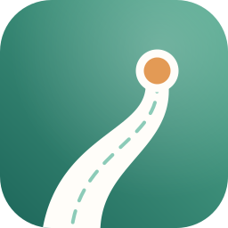
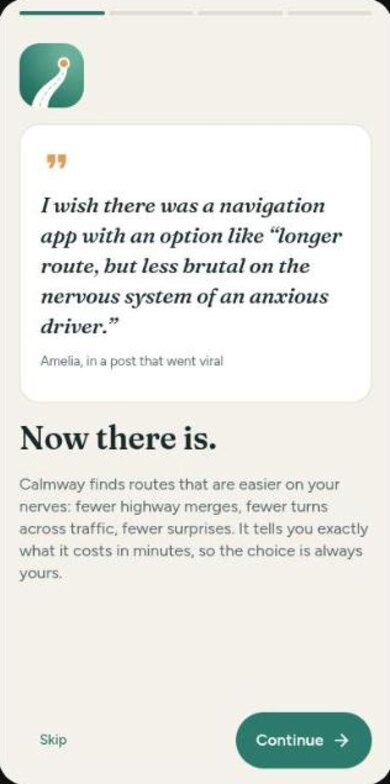
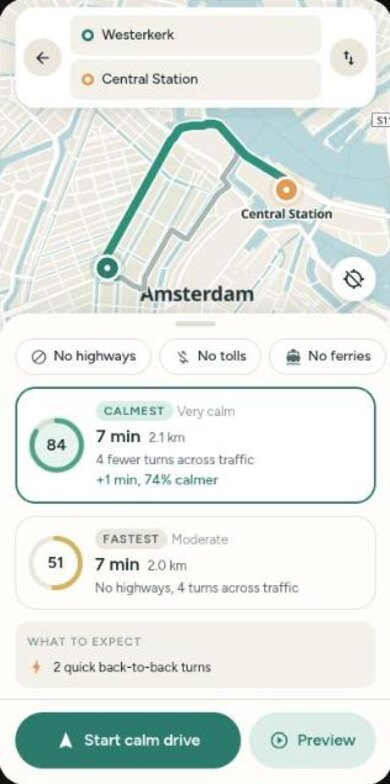
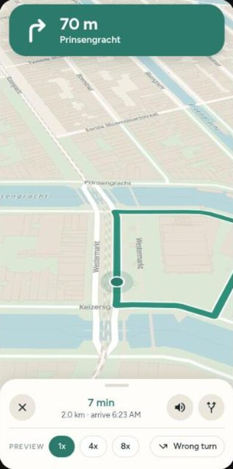

<p align="center">
  
</p>

<h1 align="center">Calmway</h1>

<p align="center"><b>Longer route, calmer drive.</b><br/>Navigation for anxious drivers, on iPhone, Android and the web.</p>

<p align="center">
  <a href="https://ary-x86.github.io/calmway/">Open the web app</a> ·
  <a href="docs/DEPLOY.md">Run and release</a> ·
  <a href="docs/ARCHITECTURE.md">How it works</a>
</p>

---

> I wish there was a navigation app with an option like "longer route, but less brutal on the nervous system of an anxious driver."
>
> Amelia, in a post that went viral

Map apps are built to save minutes. Calmway is built to save nerves. It still knows the fastest way, but it also finds the gentlest one: fewer highway merges, fewer turns across oncoming traffic, fewer roundabouts and back-to-back decisions. Then it tells you exactly what that costs, like **+1 min, 74% calmer**, and lets you choose.

<p align="center">
  
  
  
</p>

## Features

**The calm part**

- **Calm score** from 0 to 100 for every route, built from what actually stresses drivers: merging onto highways, interchanges, turns across traffic, U-turns, roundabouts, forks and turns that come right after each other.
- **Personal**: tell it what gets to you (highways, merging, roundabouts, ...) and those count extra.
- **Honest trade-off**: calm routes are only suggested within the extra time you said is okay, and every card shows the difference in minutes.
- **What to expect** before you leave, with the tricky spots marked on the map.
- **A calmer co-driver**: earlier and gentler voice prompts before tricky maneuvers, a "next tricky part" heads-up, a check-in on long quiet stretches, and a no-drama reroute ("No problem. Finding you a new calm route.").

**The map part**

- Search with autocomplete, nearby categories (gas, charging, parking, coffee, food, rest stops), long press to drop a pin.
- Place details with save, share, and set as home or work. Recent searches and saved places stay on your device.
- Directions with alternatives, avoid highways, tolls or ferries, and a route overview.
- Turn-by-turn navigation with a follow camera, spoken directions, ETA and automatic rerouting.
- **Preview** any route as a simulated drive at 1x, 4x or 8x, including a deliberate wrong turn. Handy for nerves and for testing at a desk.
- Light and dark themes, metric and imperial (automatic per country), and a sidebar layout on wide screens.

## Quick start

```bash
npm install
npm run web          # opens at http://localhost:8081
```

No API keys needed. See [docs/DEPLOY.md](docs/DEPLOY.md) for running it on your phone, store releases and production map services.

| Script              | What it does                                 |
| ------------------- | -------------------------------------------- |
| `npm run web`       | Start the app in the browser                 |
| `npm start`         | Start the bundler for a development build    |
| `npm run android`   | Build and run on Android (needs Android SDK) |
| `npm run check`     | Typecheck, lint and run the tests            |
| `npm run build:web` | Export the static web build to `dist/`       |
| `npm run icons`     | Re-render all icons from `assets/brand`      |

## Built with

[Expo](https://expo.dev) and React Native, [MapLibre](https://maplibre.org) (native and web), [Valhalla](https://github.com/valhalla/valhalla) routing, [Photon](https://photon.komoot.io) search, [OpenFreeMap](https://openfreemap.org) tiles and [OpenStreetMap](https://www.openstreetmap.org/copyright) data. Type: Fraunces and Figtree.

## Safety

Calmway gives suggestions, you are the driver. Always follow road signs, local laws and your own judgement.

## License

[MIT](LICENSE). Map data © OpenStreetMap contributors.
